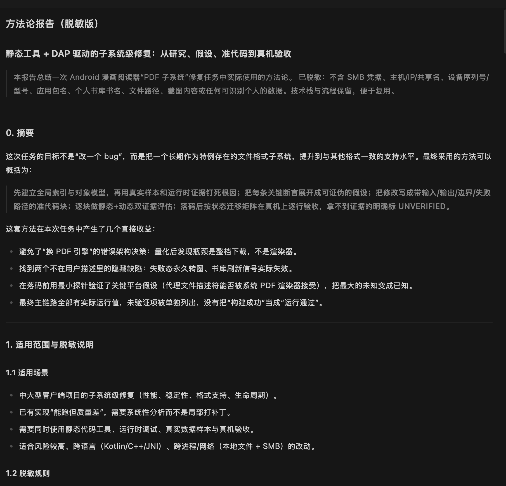
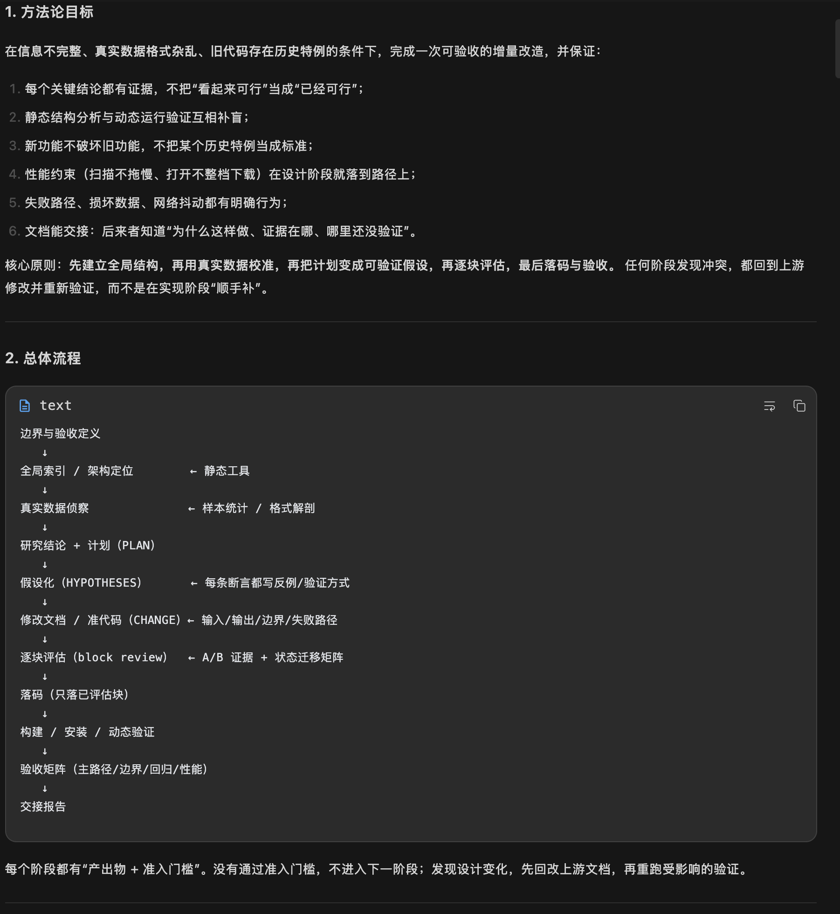

# 事实驱动编程（Static + DAP Socratic）

给 AI 编程助手用的阶段式事实/证据工作流：把复杂任务拆成六步，一次只做一步；每一步交一份报告，插件再发下一步。

- 插件 ID：`static-dap-socratic`（保持不变，避免破坏安装与 Skill 引用）
- 版本：`2.0.8-case-study`
- 配套 Skill：`plugin/static-dap-socratic/skills/static-dap-socratic/SKILL.md`
- 许可证：MIT

## 前置条件（必须）

这个插件**不生产事实**。事实来自外部工具；没有这些工具，它只是一个阶段提示器，不是“事实驱动”。

| 能力 | 用途 | 缺失后果 |
|---|---|---|
| `codebase_memory` MCP | 全局代码索引、符号、调用关系、数据形状 | 只能靠 grep/读文件，容易把全局问题看成局部片段 |
| DAP MCP | 调试器：实际运行值、线程、分支、生命周期 | 运行时契约只能靠日志/测试/探针，相关结论必须标 `UNVERIFIED` |
| Python 3 + ZCode 插件系统 | 运行 hook、handoff、报告归档 | 插件无法加载 |

最小检查：能调用 `codebase_memory.index_repository` / `search_graph`，能调用 `dap.capabilities` / `dap.start`。缺一个，先配置 MCP，再激活。

DAP 的具体能力契约、底层依赖库（CodeLLDB/LLDB、debugpy、Node Inspector/CDP、原生 JDWP、netcoredbg）、当前实现状态和已知限制（尤其 Android/ART/JDWP 断点限制）见 **[docs/dap-spec.md](docs/dap-spec.md)**。

## 如何触发

在给 AI 的任务描述里包含这句话：

```text
基于静态工具与dap联合
```

插件会自动进入第一阶段。没有这句话不会触发。

## 快速开始

1. **安装**：把本仓库根目录添加为 ZCode 的本地插件市场，安装 `static-dap-socratic`，重启 ZCode。
2. **触发**：在任务描述里写上 `基于静态工具与dap联合`。
3. **跟进**：按当前阶段提示工作，写当前阶段的报告，运行提示里给的 handoff 命令；插件会发下一阶段。

## 它解决什么问题

AI 编程助手常见四个毛病：

1. 一上来就改代码，还没看清项目结构和关键假设；
2. 把“猜”当成“验证过”，只看代码推断，不看实际运行结果；
3. 长任务跑偏、漏项、跳步；
4. 用户只知道“它说做完了”，不知道它查了什么、依据是什么、哪里还没验证。

这个插件用**分阶段 + 阶段报告**解决这四个问题。

## 六个阶段

| 阶段 | AI 要做什么 | 要交什么 |
|---|---|---|
| 1. 调研与计划 | 看项目地图和真实样本，理清现状，写计划 | 研究计划 |
| 2. 计划验证 | 把计划里“以为成立”的关键点逐条验证 | 假设验证报告 |
| 3. 修改方案 | 写清目的、背景约束、准备改哪些地方 | 修改方案 |
| 4. 逐块检查 | 对每个准备改的块，先查现有代码，再做小实验/测试，确认可行 | 逐块检查报告 |
| 5. 改代码 | 按方案落地，构建、安装、测试 | 落码报告 |
| 6. 验收 | 按真实场景逐条验证，记录实际结果 | 验收报告 |

插件一次只发当前阶段，不提前展示后面几步的具体内容。

## 优势

- **先研究再动手**：第一阶段先看项目结构和真实数据，写计划，不会一上来就改代码。
- **一次只做一件事**：长任务不容易跑偏、漏项、跳步。
- **每一步有书面报告**：查了什么、依据是什么、哪里没验证，用户能看懂、能复盘。
- **结构证据和运行证据分开**：不把“看起来对”当成“实际验证过”。
- **允许写“未验证”**：没有证据的项明确标出来，而不是包装成“全部通过”。
- **不打断工作**：插件不拦截操作、不弹审批，只在阶段边界交接。

## 实战案例：一次 PDF 子系统级修复

以下是一份实际跑完的方法论总结（已脱敏）。它展示了工作流在真实任务中的产出：先定位根因，再用最小探针验证平台假设，逐块评估后落码，最后在真机上按状态迁移矩阵验收。



*图 1：报告摘要、适用范围与脱敏说明。*



*图 2：方法论目标与总体流程。*

完整文字版：[docs/case-study-pdf-subsystem.md](docs/case-study-pdf-subsystem.md)

## 工作循环

1. 读当前阶段提示；
2. 完成这一步；
3. 写这一步的报告（文件名会写在提示里）；
4. 运行提示里给的交接命令：

```sh
python3 <plugin-root>/scripts/handoff.py --report REPORT-xxx.md --token <current-stage-token>
```

5. 插件记录报告，发下一阶段；
6. 重复直到结束。

报告和事实账本保存在本机 `~/.zcode/methodology/`；报告副本在 `reports/`，过程记录在 `facts/`。

## 隐私

- 插件在本机运行，不向外部服务发送数据，也不收集遥测。
- 阶段报告和事实账本保存在 `~/.zcode/methodology/`。
- 报告可能包含项目细节；不要把它们提交到公开仓库。

## 限制

- 插件不保证方案和代码一定正确；它保证过程有序、证据可见。
- 插件不解析、不评分报告；报告写得薄也能推进，用户需要自己看。
- 运行证据受环境影响；例如 Android 上对已加载 Kotlin 类的断点可能不命中，报告应如实说明并改用日志/数据库/界面/小实验。
- 一行小修、纯查询、时间很紧的小任务，用它会多出报告开销，通常不值得。

## 文档

- [介绍：设计思想、使用方法、优势](docs/introduction.md)
- [两次真实任务的脱敏案例](docs/field-notes-two-tasks.md)
- [DAP 设计规范与当前限制](docs/dap-spec.md)
- [实战案例：PDF 子系统级修复（脱敏）](docs/case-study-pdf-subsystem.md)

## 许可证

MIT。见 [LICENSE](LICENSE)。
