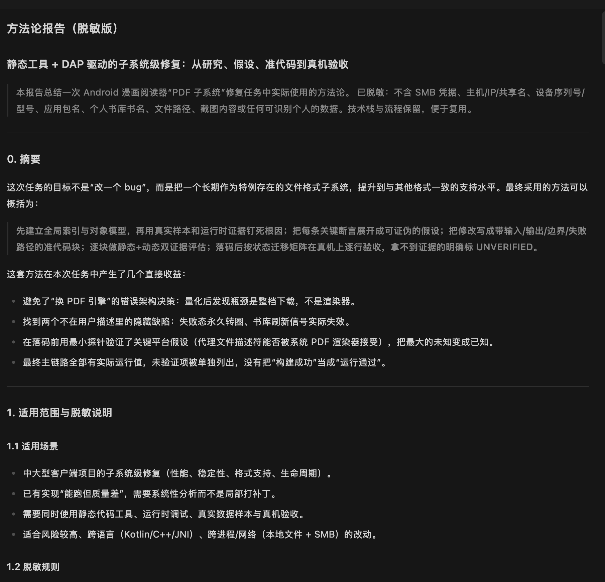
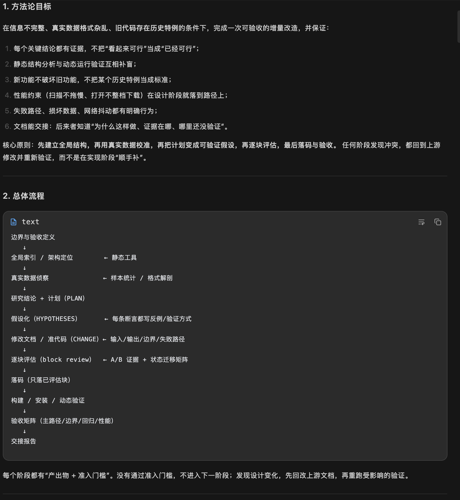

# 实战案例：一次 PDF 子系统级修复（脱敏版）

> 这是一次实际完成的 Android 漫画阅读器“PDF 子系统”修复任务的方法论总结。  
> 已脱敏：不含凭据、主机/IP/共享名、设备序列号/型号、应用包名、个人书库书名、文件路径、截图内容或任何可识别个人的数据。

## 1. 任务目标

不是“改一个 bug”，而是把一个长期作为特例存在的文件格式子系统，提升到与其他格式一致的支持水平：

- 书库封面墙：不打开书也能生成并显示封面；
- 元数据：封面生成时顺带拿到页数并持久化；
- 打开性能：远程文件不整档下载，打开耗时与文件大小解耦；
- 渲染吞吐：单书渲染串行但可见页优先，不重复渲染第 0 页；
- 失败可见：加密/损坏/离线/无空间时显示明确错误与重试，不再永久“打开中…”；
- 生命周期：UI 会话、封面临时会话、翻译后台会话都有明确关闭点；
- 不回归：ZIP/RAR/目录/EPUB/本地 PDF 的现有路径与性能不退化。

## 2. 实际使用方法

> 先建立全局索引与对象模型，再用真实样本和运行时证据钉死根因；把每条关键断言展开成可证伪的假设；把修改写成带输入/输出/边界/失败路径的准代码块；逐块做静态+动态双证据评估；落码后按状态迁移矩阵在真机上逐行验收，拿不到证据的明确标 `UNVERIFIED`。

这套方法在本次任务中产生了几个直接收益：

- 避免了“换 PDF 引擎”的错误架构决策：量化后发现瓶颈是整档下载，不是渲染器；
- 找到两个不在用户描述里的隐藏缺陷：失败态永久转圈、书库刷新信号实际失效；
- 在落码前用最小探针验证了关键平台假设（代理文件描述符能否被系统 PDF 渲染器接受），把最大的未知变成已知；
- 最终主链路全部有实际运行值，未验证项被单独列出，没有把“构建成功”当成“运行通过”。

## 3. 方法论目标

在信息不完整、真实数据格式杂乱、旧代码存在历史特例的条件下，完成一次可验收的增量改造，并保证：

1. 每个关键结论都有证据，不把“看起来可行”当成“已经可行”；
2. 静态结构分析与动态运行验证互相补盲；
3. 新功能不破坏旧功能，不把某个历史特例当成标准；
4. 性能约束（扫描不拖慢、打开不整档下载）在设计阶段就落到路径上；
5. 失败路径、损坏数据、网络抖动都有明确行为；
6. 文档能交接：后来者知道“为什么这样做、证据在哪、哪里还没验证”。

核心原则：先建立全局结构，再用真实数据校准，再把计划变成可验证假设，再逐块评估，最后落码与验收。任何阶段发现冲突，都回到上游修改并重新验证，而不是在实现阶段“顺手补”。

## 4. 总体流程

```text
边界与验收定义
    ↓
全局索引 / 架构定位        ← 静态工具
    ↓
真实数据侦察              ← 样本统计 / 格式解剖
    ↓
研究结论 + 计划（PLAN）
    ↓
假设化（HYPOTHESES）      ← 每条断言都写反例 / 验证方式
    ↓
修改文档 / 准代码（CHANGE）← 输入 / 输出 / 边界 / 失败路径
    ↓
逐块评估（block review）  ← A/B 证据 + 状态迁移矩阵
    ↓
落码（只落已评估块）
    ↓
构建 / 安装 / 动态验证
    ↓
验收矩阵（主路径/边界/回归/性能）
    ↓
交接报告
```

每个阶段都有“产出物 + 验收条件”；没有通过验收，不进入下一阶段；发现设计变化，先回改上游文档，再重跑受影响的验证。

## 5. 适用场景

- 中大型客户端项目的子系统级修复（性能、稳定性、格式支持、生命周期）；
- 已有实现“能跑但质量差”，需要系统性分析而不是局部打补丁；
- 需要同时使用静态代码工具、运行时调试、真实数据样本与真机验收；
- 适合风险较高、跨语言（Kotlin/C++/JNI）、跨进程/网络（本地文件 + SMB）的改动。

## 6. 报告截图



*图 1：报告摘要、适用范围与脱敏说明。*



*图 2：方法论目标与总体流程。*

---

> 这是任务报告中的方法论总结，不是自动评分或质量认证；插件负责阶段、报告和证据记录，最终判断仍由用户。
